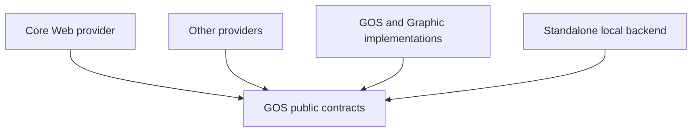

# GOS capability contracts

This directory owns the public Host/provider contracts, separate from system
implementations. [Graphics render-v1](graphics/graphics_render_v1.md) and
[resource-v1](graphics/graphics_resource_v1.md) specify graphical services;
[`file-v1`](system/graphics_file_v1.h), [`app-data-v1`](system/app_data_v1.h), [`process-v1`](system/process_v1.h), [`terminal-v1`](system/terminal_v1.h), and [`thread-v1`](system/thread_v1.h) specify system capabilities.
Core keeps Web Canvas/WebGL semantics. Interfaces alone do not enforce isolation.

## Scope and dependency direction

GOS manages lifecycle, execution, authorization and resources; its Graphic
subsystem manages graphics resources, input, presentation and device recovery.
The contracts have no dependency on Core or the system implementations.

These are target contract dependencies, not a claim about existing imports. An assembler binds provider endpoints to a backend; runtime messages flow both ways. A standalone Core may use a local backend without starting Graphics or Desktop. A managed session cannot use its Headless endpoint or local backend to bypass its Host's authority. Graphics may consume this contract without importing the Core engine.

Only provider-visible contracts and shared value types belong here. Resource ledgers, work queues, scheduling policy, registries, compositor/backend implementation, integration tests, Desktop UI and deployment details belong to their implementing project, not this public API directory. Web-specific control/export protocols remain owned by Core; adapters map them to this contract rather than importing Web types into it.
The render-v1 trusted-local transfer binding is executable without Web or private native headers: acquire an authorized target; use `mg_render_transfer_open_v1` with its negotiated kind/version and authenticated local connection; write the returned ordinary byte span using its exact row stride; close the caller-owned writer before replying with the exact operation identity. The service validates that completion before publishing. The implementation's Mach/IOSurface objects never appear in the standard declarations. Native allocation capacity is private; the standard authorizes only `byte_length = row_stride × height`.

## App data directory v1

`mioa_app_data_directory_v1` resolves one application directory from OS-owned
policy and optionally creates it recursively. It accepts only a single
application-name component; it never accepts a caller-selected base path.
Darwin uses `HOME/Library/Application Support/<name>`; other POSIX systems use
an absolute `XDG_DATA_HOME/<name>`, otherwise `HOME/.local/share/<name>`.
Windows uses its `LOCALAPPDATA` base directory.

`MIOA_APP_DATA_CREATE_DIRECTORY_V1` creates missing path components with
owner-only permissions on POSIX; existing directories keep their permissions.
Windows inherits the parent ACL. Existing symlinks are followed; this trusted
local capability is not a sandbox. The output is unchanged on failure, and a
successful result remains caller-owned until `mioa_app_data_path_release_v1`.
Statuses distinguish invalid input, unavailable host location, allocation
failure and filesystem failure.

## Environment value v1

`mioa_environment_get_v1` accepts a nonempty ASCII environment identifier and
returns an owned snapshot of its current value; `value[length]` is NUL, including
for an empty value. Absent names return `MIOA_ENVIRONMENT_MISSING`. The output
must start zero-initialized and remains empty on failure. Release with
`mioa_environment_value_release_v1`.
This is a trusted-local process environment read, not a managed Host
authorization or isolation boundary.

`mioa_environment_has_v1` validates the same identifier and reports presence
without copying the value. A present empty value reports `present = 1`; absence
reports `present = 0`. Invalid input leaves the output unchanged.

## Executable path v1

`mioa_executable_path_get_v1` returns an owned UTF-8 path for the currently
running executable, suitable for reopening that image. The output must start
zero-initialized and remains unchanged on failure; release successful snapshots
with `mioa_executable_path_value_release_v1`. The provider reports unsupported
platforms explicitly. This trusted-local capability identifies the process image;
it does not authorize access to other paths.

## Synchronous process v1

`mioa_process_run_with_stdin_v1(argv, argc, input, input_length)` executes the
explicit argument vector directly, without a shell wrapper. It inherits the
Host's environment and stdout/stderr; stdin is a private pipe to which the
provider writes the supplied bytes, then closes before waiting for actual child
exit. The process and pipe are wholly owned and reaped by the provider before
return. No child handle or process-table identity escapes.

`MIOA_PROCESS_OK` means the child exited normally with status 0.
`MIOA_PROCESS_CHILD_FAILED` covers nonzero or abnormal child termination;
`MIOA_PROCESS_START_FAILED` and `MIOA_PROCESS_WAIT_FAILED` distinguish creation
and actual-exit observation failures. Invalid arguments and allocation failures
have separate statuses. A closed stdin pipe does not by itself fail the call:
the child's final status decides, preserving pager early-quit behavior. If wait
fails, the provider attempts forced termination and reaping before returning;
the failure status does not claim confirmed exit.

The caller owns argv and input through the synchronous call. This trusted-local
capability grants process execution and inherits Host environment/output; it is
not a sandbox or a managed Host authorization boundary.

`mioa_process_capture_v1(argv, argc, stdout_buffer, stdout_capacity,
stderr_buffer, stderr_capacity, result)` directly executes argv with the Host
environment. It captures stdout and stderr as exact byte slices into separate,
disjoint caller-owned buffers; each stream is independently bounded by its
capacity. The provider owns and reaps the child before returning. A zero exit
returns `OK`; nonzero or abnormal termination returns `CHILD_FAILED`, with
captured lengths and normal-exit status populated. If either stream exceeds its
capacity or another capture/read failure occurs, it returns `CAPTURE_FAILED`
and leaves result lengths zero. A missing executable returns `NOT_FOUND`.
Caller buffers and argv are borrowed only through the synchronous call. This is
trusted-local execution, not a sandbox or managed Host authorization boundary.
`mioa_process_flush_v1()` flushes the Host's shared I/O instance and returns to
the caller. `mioa_process_exit_v1(status)` immediately exits with the exact
8-bit status without flushing buffered output and does not return.

## Terminal v1

`mioa_terminal_stderr_columns_v1()` returns the current Host stderr terminal
width in columns, or zero when stderr has no usable terminal width. The value is
queried on each call so terminal resizes are observed. The provider owns stderr
and platform-specific console/ioctl details; no OS descriptor crosses the API.

`mioa_terminal_stdin_raw_enter_v1` enters the picker's raw input mode and saves
the previous state in caller-owned zero-initialized storage. Restore returns the
terminal to that state; on failure the state remains active for retry. The
trusted-local implementation acts on stdin and is not managed authorization or
execution isolation. Callers must serialize terminal-mode ownership.

## Thread v1

`mioa_thread_start_v1(entry, context, handle)` starts one Host-owned thread
and returns an opaque token. The caller keeps `context` valid until the entry
returns. `mioa_thread_join_v1(&handle)` waits for completion, frees the token,
and clears the caller's handle. `mioa_thread_detach_v1(&handle)` relinquishes
the token without waiting, frees it, and clears the caller's handle; it does
not extend the callback context's lifetime. Start failure leaves the handle
null; invalid arguments, allocation failure and thread-start failure are
distinct. Join/detach are single-consumer; detach is neither cancellation nor
completion. No OS thread identifier or native thread object crosses the API.

`mioa_thread_start_detached_v1(entry, context)` starts a Host-owned thread and
detaches it before returning, without producing a join token. The caller keeps
`context` valid until the entry returns. It returns `OK` only after successful
start and detach; invalid callbacks and thread-start failure are reported
separately. Detached work has no join, cancellation or completion token.

## HTTP capability

`HttpRequests.get_json` is an explicit Host-authorized JSON GET, including any
proxy. The Host checks each destination and proxy; policy denial raises
`HttpRequestDenied` and must not trigger a retry to another destination.
`LocalHttpRequests` uses ambient `requests` proxy behavior and is for trusted
standalone use, not managed enforcement.

## Profile spool capability

`mioa_os_api.spool` defines Host-provided, seekable temporary storage with
explicit resource reservations. The trusted-local implementation uses an
already-enrolled per-principal grant channel and keeps the temporary file in
`mioa-os`. Successful close disposes the file before releasing reservations;
uncertain SQLite cleanup closes only the file and retains tickets. Each grant
request has a two-second total send-and-reply deadline. Timeout or channel loss
leaves its effect unknown and disables the channel; neither establishes release.
Registry close attempts every channel before reporting failure; a failed close
has unknown effect and is not retried.
This Unix-channel binding is not a portable grant, an authorization service,
or an execution-isolation guarantee.

## Profile record publication

`ProfileRecordWriter` binds a Host-selected Profile and publishes only its config
or state record. It requires the caller's Profile lease; it does not authenticate
the caller or enforce isolation. `ProfileCommitUncertain` requires reconciliation
before retry. `LocalProfileRecordWriter` binds an existing directory and is for
trusted local Hosts only; concurrent directory replacement is not prevented.
The writer is not yet connected to Core or to a managed Host.

## Profile migration Host capabilities

`WallClock.unix_time_ns()` returns Host wall time, which may repeat or move
backwards; it is not a monotonic clock or unique identifier. `AtomicDirectories`
exchanges two directory entries atomically or fails without a copy/delete fallback.
Success is not durability or isolation. `LocalAtomicDirectories` is a trusted
standalone adapter; managed Hosts must bind authorized storage operations.
`SnapshotDirectories.prepare(profile_identity)` prepares a Host-authorized private
snapshot location. The trusted-local adapter binds a Profile root, rejects
non-directory or non-owned snapshot directories and sets mode 0700; it does not
defend against concurrent directory replacement or establish isolation.

## Authorization request semantics

Target design; no user-approval service or enforced execution isolation is
implemented by this contract. The authenticated caller, requested action,
resource scope, purpose and authorization lifetime are bound to a Host-owned
request. Caller-supplied labels are display data, not identity or authority.
Capability grants and approvals of a particular side effect remain distinct.

Status queries do not prompt. An asynchronous request exposes a request identity
and pending status before the final result; callers may await or observe the
same request without occupying a thread. Final outcomes distinguish allowed,
user-denied, user-cancelled, caller-cancelled, no-response expiry, unavailable
presentation and policy denial. Only a request actually presented and unanswered
can produce no-response expiry. A bounded Host-selected deadline dismisses the
MIOA-owned prompt; expiry is not denial and a new request may be made, subject
to platform and anti-abuse policy. OS-owned dialogs may not support dismissal:
the adapter reports their separate state, and a late OS decision never revives
the expired MIOA request.

The Host serializes decision, cancellation and expiry against the matching
request. A late decision cannot grant a new or expired request. Approval grants
only the displayed action and scope; privileged use checks current authority
again. Revocation blocks new use but cannot undo already-dispatched effects.
Disconnected clients, duplicate submissions and unknown side-effect outcomes
do not prove a decision or justify automatic replay. No UI channel or execution
backend may claim this target as implemented without end-to-end evidence.

On Windows, macOS, iOS and Android, adapters map this contract to each platform's
actual permission and lifecycle rules; no platform support is implied. Effective
access requires both the MIOA principal's grant and any applicable OS grant and
resource restrictions. An OS-level grant to the MIOA app does not authorize every
contained Web app or Agent. Background/unavailable presentation differs from
an unanswered displayed prompt; application suspension, platform dismissal,
revocation and restart require reconciliation rather than assumed outcomes.

## File-v1 native binding

`system/graphics_file_v1.h` is the public native handle interface. The private
implementation is `../files.c`, outside the restricted Core roots. Host creates one
endpoint per authenticated connection and assigns a unique nonzero epoch across
owner lifetimes. Host serializes negotiation, grants, calls, revoke and destruction;
no concurrent close/revoke versus I/O is supported by this local binding.

Host grants a duplicate of an already-authorized regular-file descriptor, rights
and a bounded base/length. Core sees only endpoint and generation-bearing handle;
offsets are relative to the grant. Host retains namespace lookup, creation,
truncation and authority decisions. It must not mutate shared descriptor flags
during the grant lifetime. Append descriptors and nonregular files are refused.
Read/write use positional I/O, preserve the shared file cursor, allocate no
per-call storage, and return actual short counts or EOF without filling a request
through hidden retries. Calls are limited to 1MiB and checked against grant range;
EINTR without progress may be retried, never a partial write or unknown outcome.
Success is not durability. No fsync, directory or atomic-publication capability
is implied.

Negotiation rejects unknown versions/required features with output unchanged;
failed renegotiation preserves an existing selection. Rights cannot be widened.
Revocation rejects new reads/writes but allows close. Close consumes the handle
even on I/O error; stale/duplicate/cross-connection handles cannot affect a
replacement. Host must treat close errors as unresolved resource outcomes, not
proof of release, and must never replay the old descriptor close.

The provider requires 64-bit POSIX offsets and storage sizes. Owner initialization
allocates fixed slot storage; reads/writes/close/revoke are O(1), grants/destruction
O(capacity), with a 65536-slot ceiling. Exhausted slot generations are never reused.
Endpoint destruction ends all borrowed endpoint lifetimes.

This is a trusted-local C binding, not an authenticated transport or execution
sandbox. `MG_FILE_ISOLATED` is required-feature vocabulary, **not implemented**:
the provider refuses it before owner allocation, and clients cannot negotiate it.
The native handle service is not yet wired into Core; these declarations do not
establish managed isolation.
Local smoke: `tests/test_os_files.py` compiled the actual provider and passed
8/8 real temporary-file scenarios (positional range/cursor, rejected writes,
EOF, rights/revoke/reuse, duplicated-descriptor lifetime, capacity/connection,
required isolation refusal, source access/append). Controller/boundary regressions
passed 26/26; replay of the initial FAIL produced the new edit locations and steps
without changing that report. This is not cross-platform ABI qualification,
close-error fault injection, full CI acceptance or a sandbox test.

## Python artifact discovery

`mioa_os_api.ArtifactDiscovery` is an explicitly installed Host capability for
choosing a default native binary and discovering font paths. Explicit artifact
paths do not require discovery; an explicitly empty font list is validated as
provided, not replaced by discovered fonts. When discovery is needed and absent,
Core fails with `capability_unavailable`. Core still validates actual artifact
paths and pins, and rejects an empty discovered font list.

`mioa_os.LocalArtifactDiscovery` is an ambient trusted-local backend. It selects
`ANTI_TRACE_<RUNTIME>_BINARY` when nonempty, otherwise the supplied repository
default; it recursively discovers actual `.ttf`, `.otf` and `.ttc` files in
the macOS system, local and user Library font directories, returning sorted,
deduplicated resolved paths. Missing font entries and directories are skipped;
other filesystem errors propagate. A font may disappear after discovery and must
still be validated.
This backend is not authorization or managed isolation and must not be implicitly installed for
supervised preparation; a managed Host must supply explicit paths or its own
appropriate discovery capability. Core never imports the local backend.

## Python artifact content

`mioa_os_api.ArtifactContent` is an explicitly installed read capability for
artifact bytes already selected by Core or the caller. It grants no discovery,
provenance or policy authority. Core still pins digests and compares bytes.
`resolve` expands the user and returns an absolute resolved path without
requiring existence; `executable` returns an absolute resolved regular file with
execute permission or raises `OSError`; `fingerprint` returns stat identity used
only as a cache hint, so equal fingerprints do not prove unchanged bytes;
`size` and `digest` require a regular file; `read` returns exactly `length`
bytes from `offset` and rejects invalid bounds. `digest` and `read` verify file
identity before and after the operation and raise `OSError` rather than return
bytes that changed. Core maps these failures to `capability_unavailable` or
`incompatible_profile`.

`mioa-os/mioa_os.LocalArtifactContent` implements this contract over ambient
local files for an explicitly trusted Host. It is not authorization or managed
isolation, and Core never imports it.

## Python stream connections

`mioa_os_api.StreamConnections` is an explicitly installed connector for the
native manager's loopback HTTP/CDP probes and for adopting an inherited,
already-authenticated Unix channel. `connect_tcp` and `adopt_unix` return owned
async reader/writer pairs; failures propagate without an ambient network or
retry fallback. `reserve_loopback_port` returns a port free at observation time;
another process may claim it before the child binds. Core still enforces
loopback-only native endpoints and receipt digests.

`mioa-os/mioa_os.LocalStreamConnections` implements this over asyncio and
ambient sockets for an explicitly trusted Host. `adopt_unix` sets the channel
nonblocking and transfers it into the async transport. It is not authorization
or isolation, and Core never imports it.

## Python host files

`mioa_os_api.HostFiles` covers Core-owned directory and whole-file operations:
`make_directory` (missing parents, requested mode, existing directory accepted),
`read_bytes`, `write_bytes` (create/truncate, no durability), `exists`,
`is_symlink` (without following it), `is_file` (regular file), `size` (regular
file only) and `remove` (one file or symlink, never a tree). The Host resolves
paths and errors propagate. Atomic publication, fsync, permissions of existing
entries and isolation are not implied.

`mioa-os/mioa_os.LocalHostFiles` implements this over ambient local paths for an
explicitly trusted Host. Core never imports it.

## Python Unix channel readiness

`mioa_os_api.UnixChannels` is an explicitly installed readiness and nonblocking
primitive for connected Unix streams owned by the caller. Handles are opaque,
hashable and already connected; the same handles are accepted by `UnixMessages`
and `ProfileLeases`. `pair` returns two owned connected handles.
`register`/`modify`/`unregister` choose which handles `select` reports, and
`select` blocks until at least one registered handle is ready, reporting
readability and writability separately. `peek` returns available bytes without
consuming them. `receive_available` returns bytes when readable or `None` when it
would block, and leaves the handle on the Profile protocol's one-second receive
timeout. `shutdown` disables further sends and receives. `close` closes only the
readiness state; the caller still owns every channel handle. Errors propagate;
there is no implicit backend, fake readiness or retry.

`mioa-os/mioa_os.LocalUnixChannels` implements this over `selectors` and ambient
Unix sockets for an explicitly trusted Host. It is not authorization or
isolation, and Core never imports it.

## Trusted-local Python file export

`mioa_os_api.FileExports` is a separate synchronous path-export protocol,
not a Python binding of the native handle ABI. Host explicitly installs it in
`Engine(file_exports=...)`; NativePage resolves the root application's service
for `screenshot(path=...)`. Missing authority rejects before capture; validated
image bytes reach the service only after capture succeeds. Bytes-only screenshots
require no file service.

`mioa-os/mioa_os.LocalFileExports` implements create/truncate/write/close with
short-write completion using views over the original bytes. Errors propagate and
may leave a truncated/partial file. Paths are resolved at the Host; parents are
not created. Private exports open nonblocking and set mode bits to `0600` before
truncation or writing, including for existing files; a FIFO without a reader
fails rather than waiting. Mode bits do not remove ACLs or provide isolation.
No atomic publication, durability, preemptible deadline, revocation
protocol or sandbox is implied. Standalone Headless explicitly installs this
ambient-path service; supervised Headless does not. A managed assembler must
provide its own authorized implementation rather than install this backend.
Core never imports `mioa_os`.

The API distribution has no third-party runtime dependencies; the trusted-local
Host distribution requires `psutil` for profile owner identity checks.
Their installation is distinct from source-mode regression evidence.

## Python Unix endpoint leases

`UnixEndpoints.create()` returns one `UnixEndpoint` with read-only pathname and
diagnostic-directory values plus `dispose()`. Host injects the factory through
`start_supervised_profile(..., supervisor_channel=..., endpoints=..., blocking_calls=..., messages=..., profile_command=...)`; Core retains
launch/exit decisions and never creates or deletes these paths itself.
There is no implicit backend.

`mioa-os/mioa_os/endpoints.py` supplies `LocalUnixEndpoints`: unique mode-0700
directories directly under `/tmp`, independent of HOME/TMPDIR, with socket paths
shorter than the supported 104-byte limit. Persistent Profile/config/data stay
where they were. Disposal removes only a socket at the issued address and its
empty directory. Non-socket files, symlinks and unexpected contents are preserved
and reported as errors. After successful disposal, the lease cannot delete a
replacement at the same pathname.

Only a never-issued launch, authenticated pre-admission rejection, or confirmed
matching child exit permits Core to dispose. Timeout, EOF and uncertain spawn
retain the lease. These pathname services do not authenticate the transport,
terminate a process, prove exit or establish sandbox confinement. The local
caller serializes allocation/disposal and owns the release decision; no finalizer
guesses from object collection or connection loss.
## Python Profile data reset

`ProfileDataReset.reset` is an explicit destructive Host capability used by
`profile.reset_data`. It removes and recreates the Profile's data directory,
then removes `engine.log`, `engine.sock` and `state.json`, preserving config and
locks. Failures propagate and may leave partial changes. The caller must arrange
lease and owner exclusion; reset itself does not establish either.
`mioa_os.LocalProfileDataReset` uses ambient path authority and is for trusted
local Host assemblies only, not a managed sandbox or an authorization boundary.
Managed Hosts must supply an appropriately authorized service instead.

## Python Profile leases

`ProfileLeases.acquire` returns an owned opaque lease or `None` when busy.
Host supplies the service to Profile operations and supervised startup; standalone
child launch borrows the active engine lease. The local backend holds compatible
store and legacy locks, rolls back partial acquisition, and retains inherited or
escrowed copies until their owners close them. Transfer failures close unclaimed
copies; control-channel loss is not proof that a child has exited.
For an existing Profile directory, engine/spawn acquisition creates missing
legacy lock files before granting the lease, excluding older local owners too.
Closing an owned local lease or rolling back acquisition attempts every opened
lock even if one close fails, then reports the first error. A failed close does
not prove release and is not retried.

The capability hides local descriptors from lease consumers; it is not a sandbox.

## Python Profile owner observations

`ProfileOwners` is injected into Profile operations and Engine. The trusted-local
`LocalProfileOwners` records process identity outside profile archives, checks
process creation time and zombie status, and recognizes legacy state identity.
Unreadable or malformed records, including incomplete legacy identities, fail
closed. New Profile state and ready events do not expose process IDs. Liveness is
not lease ownership, exit evidence, durability or isolation; Profile operations
still acquire the required leases.

## Python child environment

`ProcessEnvironment.derive(remove=..., overlay=...)` returns an independently
mutable copy of a Host-authorized base: remove keys first, then apply overlay.
It changes neither the parent nor the overlay and does not retain the result.
Failure propagates before spawn. It neither resolves credentials nor launches a
process; Core keeps native runtime filtering and binds logs to the launch proxy.

Host supplies this service through `Engine(process_environment=...)` or
`launch_native(..., process_environment=...)`. Missing Engine authority rejects
standalone launch with `capability_unavailable`, without a direct fallback.
`mioa_os.LocalProcessEnvironment` copies the current ambient environment for an
explicitly trusted standalone Host only. Headless installs it only on that path;
supervised execution continues through its supervisor, not this service.
This is child-environment derivation, not sandboxing, credential revocation or
whole-Core environment migration.

## Python proxy secrets

`ProxySecrets` is a Host-bound authority for proxy lookup and durable private
storage. `resolve(name, identity)` consults the environment first and may read
the owned stored value only when identity is supplied; `read(identity)` bypasses
the environment, while `write(identity, value)` and `delete(identity)` manage
the stored value. Errors propagate. A configured reference with no service
fails `capability_unavailable`; an empty or absent value fails
`network_unavailable`. DIRECT needs no service unless an owned secret must be
deleted. Private migration snapshots and rollback use stored-only reads.
`mioa_os.LocalProxySecrets(root)` binds storage to an explicit trusted-local
Host root and enforces owner-only file safety and atomic replacement. The Host
is responsible for the root and its ancestors being durable; the adapter syncs
both private directory entries before publication and the credential and its
containing directory during replacement. A failure after replacement leaves the
publication outcome uncertain. Deletion syncs the containing directory even when
the credential is already absent, if that directory exists; a sync failure
leaves deletion durability uncertain and a retry must sync again. Reads open
nonblocking so a FIFO without a writer is rejected rather than waiting; device
and filesystem I/O latency is
not bounded.
Headless installs it only for standalone execution; supervised execution rejects
proxy references and has no ambient fallback. This does not provide isolation.

## Python authorization

`mioa_os_api.authorization` defines Host-bound authorization endpoints and
opaque asynchronous requests. `mioa_os.authorization.HostAuthorizationEndpoint`
is an in-process coordinator, not an identity provider, prompt or sandbox. The
trusted Host constructs it on a running asyncio loop with an already-authenticated
principal, capability-specific `AuthorizationPolicy` and optionally an actual
`AuthorizationPresenter`. The Host must not derive principal identity from
`Intent` text. Its policy snapshots caller input into a Host-owned immutable
intent, including a scope with no mutable aliases, before validating it. The
same snapshot is presented and authorized; generic frozen `Intent` alone does
not freeze nested values. Policy queries and rechecks current authority, honors
the requested lifetime as an upper bound, and produces immutable grants.
Privileged use must independently enforce current authority and platform restrictions.

`status` does not prompt. `begin` validates synchronously and returns immediately;
the policy and presenter run on the endpoint's asyncio loop. They must not block
that loop. All endpoint and request operations and presenter callbacks belong to
that same loop. The presenter calls `shown()` only when the actual UI is visible,
then returns a `PresentationDecision`. No presenter, a presenter error, unexpected
presenter cancellation or a decision without a shown UI produces
`PRESENTATION_UNAVAILABLE`, not user denial.
Only a shown, unanswered prompt can expire; `prompt_timeout` is optional and
starts at `shown()`. Cancellation and expiry cancel the presenter coroutine;
the presenter should dismiss its UI, but OS-owned dialogs may not be dismissible.
Waiters suspend asynchronously; cancelling a waiter leaves the request pending.
The first terminal decision, request cancellation or expiry wins for every
waiter, and late decisions cannot authorize. Existing authority still requires
an explicit policy `authorize(..., approved=False)` result; user approval calls
it with `approved=True`. Policy errors while processing a request fail closed
as `POLICY_DENIED`; validation and direct status errors propagate. None of this
authenticates callers, installs a prompt, provides platform permission, persists
grants, revokes already dispatched actions or isolates execution.

For an asynchronous smoke scenario, assemble a real Host policy for a specific
capability and a real presenter, bind an authenticated principal, call `begin`,
start two `wait()` tasks, show the prompt and approve it through that presenter.
Both tasks should receive the same policy-issued result; a subsequent `cancel()`
must return that same result. Exercise unavailable presentation separately.
`tests/test_os_authorization.py` contains a loop-driven coordinator scenario
using a controlled presenter; it does not demonstrate an OS prompt or sandbox.

## Python secure randomness

`SecureRandom.bytes(count)` returns exactly the requested cryptographically
secure random bytes or raises; it grants no other OS access. The trusted Profile
Host injects `LocalSecureRandom` into its storage owner and Core. Profile
creation uses it for the seed and identity; migration keeps both unchanged.
Storage generates stream tokens; Core generates page, frame and observation IDs;
native transport generates WebSocket keys, frame masks and its ready-file nonce.
Missing or malformed authority rejects
Profile creation; native transport rejects malformed bytes before writing, and
native launch rejects a malformed ready nonce before spawning. Failures
propagate without an ambient fallback. This service does not establish isolation.

## Python child processes

`ChildProcesses.start(argv, environment=..., profile_lease=...)` snapshots argv
and environment and executes directly, without a shell or ambient environment
inheritance. Besides three private pipes, only the optional opaque profile lease
is inherited. The caller keeps its lease live until start ends; it is not consumed.
Success transfers a `ChildProcess`: raw return code, independent stdout/stderr
readers, `terminate`, `kill` and actual-exit `wait`. Parent-EOF stdin stays open
until exit. Wait cancellation neither kills the child nor closes its output.

Cancellation before transfer settles creation, then kills/drains/reaps an
unclaimed child before cancellation escapes, including repeated cancellation.
Creation errors propagate without retry; cleanup errors remain explicit rather
than becoming exit evidence. The receiver owns delivered-child shutdown and log
drainage. Core retains its graceful-then-forced policy and flush diagnostics.

Host supplies `Engine(child_processes=...)` or the required
`launch_native(..., child_processes=...)` argument. `mioa_os.LocalChildProcesses`
is trusted-local exec authority, installed only for standalone Headless execution.
Managed startup remains supervisor-owned; missing authority has no local fallback.
This capability does not provide a sandbox, process-tree termination or durable
storage flush. Other Core filesystem/transport dependencies remain migration work.

## Python owned blocking calls

`BlockingCalls.run(operation, discard=...)` executes bounded synchronous work.
Normal completion returns its result or propagates its error. Caller cancellation,
including repeated cancellation, waits for actual completion before propagating.
If a cancelled call finishes successfully, `discard(result)` runs once before
cancellation escapes; failed work produces no result to discard. Work/cleanup
errors during cancellation are attached as exception notes, not substituted for
the cancellation. Callers keep borrowed resources and serialization locks alive
until `run` finishes.

Host injects this capability through
`start_supervised_profile(..., supervisor_channel=..., endpoints=..., blocking_calls=..., messages=..., profile_command=...)`.
`mioa-os/mioa_os/blocking.py` supplies `LocalBlockingCalls` using the local
executor with the caller's context. Its worker is an executor Future rather than
a cancellable Task, so orderly `asyncio.Runner` shutdown also drains the work.
Core's Profile startup, application spawn and lifecycle requests use this service;
unclaimed successful Profile/CDP return channels are closed before cancellation
releases the supervisor lock.

Cancellation is not immediate: operations must provide finite I/O bounds and the
Host must keep the event loop/executor alive through draining. This is not thread
termination, rollback, a scheduler budget, child-exit proof or sandbox isolation.
Unknown child outcomes still retain their CDP leases. No direct Core fallback.

## Python supervisor channel

`SupervisorChannel.take()` transfers one connected Unix stream to Core exactly
once; errors grant no fallback. `mioa-os.LocalSupervisorChannel` consumes the
inherited `MIOA_SUPERVISOR_FD` in the trusted local Host. Core owns the returned
channel before authentication and closes it if either identity capability is
missing, authentication raises, or peer/handshake validation fails. Provider errors
propagate unchanged. A consumed adapter cannot consume a replacement environment value.
This socket-bearing Python adapter is a local binding, not a portable protocol,
process sandbox, child-exit proof or claim that other Core OS access is migrated.

## Python owned Unix messages

`ManagedPeerIdentity` binds one authenticated supervisor channel and decodes
identity-bearing enrollment and READY frames into Host-owned opaque handles.
The trusted-local Darwin implementation checks supervisor EUID; child READY must
match the enrolled launch, PID and local EUID, and the connected CDP peer must
match that PID/EUID with a nonzero kernel audit-token version. Both peers must be
Unix stream sockets, checked using the kernel's socket type rather than a
caller-supplied socket wrapper type. A mismatched or incomplete token is rejected;
socket errors propagate. Identity frames reject duplicate JSON object fields,
including nested fields; Core closes owned channels on rejection or error. This
binding neither establishes isolation nor provides a fallback.

`UnixMessages.receive(channel, max_bytes=..., max_sockets=...)` borrows a connected
Unix stream and reads one 4-byte big-endian length plus body, collecting rights
across header/body fragments. Bounds are 1–1048576 bytes and 0–4 sockets;
supervisor replies remain capped at 16384 bytes, Profile control at 1 MiB.
The result owns validated connected Unix stream sockets, in wire order and
non-inheritable. Any framing, ancillary or adoption failure closes the entire
received batch; the caller must discard the borrowed channel after failure.
Core retains the transfer counter, exact descriptor count and ACK policy.
ACK follows successful OS adoption and Core receipt validation; failure closes
unclaimed sockets. Identity-bearing payloads are decoded by `ManagedPeerIdentity`.
Senders retain socket copies until receipt ACK. Early donor close can invalidate
Darwin cross-process socketpair handoff even after a successful send; see the
[independent reproduction](https://dovecot.org/mailman3/archives/list/dovecot@dovecot.org/thread/7DWJHYFU5IUKMAMNLNYV7NGKAM53CHGJ/).

`send_sockets(channel, body, endpoints, max_bytes=...)` borrows the channel and
up to 4 donor sockets. The body must be 1–`max_bytes` bytes, with `max_bytes` at
most 1 MiB. Rights are attached once; a short send completes without reattaching.
On error the caller must discard the channel; neither success nor failure closes
donors or provides a receipt ACK. Retain copies until protocol confirmation.

`UnixMessages.reader(...)` returns an explicitly closed `UnixMessageReader` for
selector-driven control input. `read_available()` uses per-call nonblocking
receive: None means incomplete, with bounded bytes/rights retained by OS; a
complete frame transfers one validated socket batch without reading ahead.
The borrowed channel must keep timeout None or 0; positive timeouts are rejected
before consumption. No socket flags are changed. EOF/error is terminal; close
discards only pending rights, not the channel or already returned sockets.
The Profile selector uses this reader so incomplete enrollment headers/bodies
cannot stall existing domain RPC or storage. Core retains JSON/identity/ACK
policy and closes the reader on control loss and owner shutdown.

Host injects `messages=mioa_os.LocalUnixMessages()`. The Darwin backend reserves
the XNU kernel batch ceiling (512 rights), not just the protocol maximum:
ancillary truncation can install descriptors without exposing their numbers.
It receives the full kernel batch before enforcing the smaller protocol limit.
The C sidecar likewise reserves 512 rights, enforces its smaller protocol cap,
and closes visible rights on malformed or truncated messages. This ceiling is
XNU-specific, not a guarantee for unqualified platforms.
See [XNU](https://github.com/apple-oss-distributions/xnu/blob/main/bsd/kern/uipc_usrreq.c)
and the [Darwin truncation report](https://github.com/bytecodealliance/rustix/issues/1683).

The Unix lease backend transfers regular-file escrow copies internally. It
rejects sockets, pipes, directories and partial/oversized batches; received
copies are non-inheritable and close without changing shared offsets, flags or
locks. File type checking does not authenticate Profile identity or prove a
lease. Core receives only opaque `ProfileLeaseCopy` objects.

Core's `profile_service.receive_leases(..., leases=...)` validates JSON, request
identity, success and a nonempty batch of opaque owned copies. Supervisor escrow
confirmation remains Core policy; `ProfileLeases` owns local lock creation and
descriptor transfer.
Headless supplies `profile_command=mioa_os.profile_owner_command()`, an explicit
local Host bootstrap prefix. Core appends inherited endpoint arguments without
importing an OS implementation. `mioa_os.profile_host` adopts those endpoints,
installs local capabilities and emits the legacy PID-bearing readiness frame;
Core signals readiness without accessing the process ID. No Core module-entry fallback.
Malformed control frames, rejected identities or invalid descriptor batches close
unclaimed resources and enter control-loss draining, not immediate owner exit.

## Shared value types

[`system/lease_types.h`](system/lease_types.h) defines the authority-scoped
`mg_lease_key` identity and generation, not a capability.
[`graphics/graphics_types.h`](graphics/graphics_types.h) includes that shared type and declares:
- `mg_gpu_image` / `mg_gpu_plane`: negotiated linear image metadata, owner/device identity, access rights and byte ranges.
- `mg_gpu_limits` / `mg_gpu_layout`: selected backend import limits and checked plane spans.

The header has no stateful objects, functions, allocator, queue, locks, platform dependencies or Web-engine imports. Storage layouts are source-level values, not a stable binary or serialized representation. Authenticating handles, checking bounds and rights, tracking completion and releasing resources are implementation responsibilities. Sharing this header does not grant access to any resource.

The image types cover single-level linear R8, RG8, RGBA8, BGRA8 and NV12 interchange. Negotiation rejects unsupported representations; other GPU layouts need their own qualified binding rather than being interpreted as linear memory. This is an interchange capability boundary, not a limitation on Canvas/WebGL semantics.

## Semantic objects

The names below describe semantic types, not a chosen memory layout or wire encoding.

| Object | Meaning and authority |
|---|---|
| Host / Connection | One governing instance and an authenticated provider connection; each has a distinct lifetime identity |
| AppInstance / ExecutionDomain | Logical application / actual scheduling, protection, accounting and termination boundary; neither is a Tab, View or bare PID |
| Principal / Capability | Authenticated subject / authority-issued object reference with rights and revocation identity; caller-supplied IDs are not authority |
| Surface / View / Binding | Provider-owned content / display attachment / accepted geometry and configuration revision; one authoritative configuration writer per Surface |
| BudgetGrant | Parent scope, resource category, epoch, amount, unit, enforcement strength and expiry/revocation conditions; child grants cannot exceed the parent |
| ResourceLease | Resource identity, connection/device generation, permitted range and access, producer-ready dependency, consumer uses and release condition |
| Request / Submission | Connection-scoped request identity / unique content-use identity; acceptance, dispatch, completion and presentation are separate facts |

Generation-bearing identities must not alias objects after reconnect, restart or device replacement. Shared services charge work to its requesting scope or an explicit system budget. Shared resources are accounted once, with every holder tracked. Resource ownership, authorization and safe physical release are separate properties.

## Service boundary

Directions: P = provider, H = Host; binding/configuration requests require a separately authorized client. All applicable calls carry authenticated connection context, scope/object generations, request identity and authority references. Resource-bearing requests additionally declare bounded size/work and any deadline. Payload IDs never replace transport authentication.

| Family / direction | Request or event contents | Result and required semantics |
|---|---|---|
| Connect / P → H | Contract identity; provided and required capabilities; execution-domain identity and required isolation; provider-specific configuration reference | Selected compatible contract/capabilities and fresh connection identity, or refusal before application side effects. Registration alone does not start an application |
| Lifecycle / H ↔ P | App/domain identity; start, quiesce, resume or stop intent; actual execution and child-task facts | Actual state and reason. Install constraints before work starts; stopping rejects new work; exited requires domain termination and resource/child settlement, not just a stop acknowledgement |
| Capabilities / P ↔ H | Target handle, requested rights, derivation/transfer/revocation request and epoch | Only authorized narrowing or explicit transfer; final-use validation orders dispatch against revocation. Already dispatched side effects remain completed or unknown, not rolled back |
| Execution and budget / H ↔ P | Scope/category, grant epoch, units, limit/reservation/weight, deadline, requested enforcement; usage and relinquishment evidence | Actual execution strength and measured use remain distinct from policy. Relinquishment acknowledgement does not free occupied capacity. Missing required enforcement rejects admission |
| Memory, I/O and child work / P ↔ H | Parent scope/grant; allocation class, size/alignment/range or bounded request descriptor; access; completion/cancel identity | Reserve before allocation/commit or launch; children inherit constraints before execution. Rejection leaves no half-initialized object; dispatched work is tracked through completion or unknown outcome |
| Surface binding / authorized client → H ↔ P | Surface/View generations; target, size, scale, clip/transform; expected binding revision, configuration authority epoch | Host acceptance and provider configuration completion are distinct. Only confirmed matching geometry becomes interactive; mirrors do not become additional configuration writers |
| Input / H → P | Binding and focus/capture epoch; sequence/time; coordinates and their space; presentation basis; actor authorization | Route rejection, provider rejection, execution result or unknown. Provider retains content hit-testing and final domain authorization. Focus does not confer application permissions |
| Content / P → H | Surface/binding/content identity, damage baseline, size/format/alpha/color space, bounded resource descriptors and readiness dependencies | Accepted/rejected followed by separate submit/complete/present evidence where available. Invalid versions/formats/ranges are rejected; no guessing a resource layout |
| Release and device events / H ↔ P | Lease/use identity, connection/device generation; completion, cancellation, disconnect or device-loss evidence | Release only after all actual users finish or safely terminate. Timeout, View closure, disconnect and generation change are not completion evidence |

Failure outcomes must distinguish malformed input, incompatible contract, unsupported required capability, unauthorized/revoked authority, stale identity/revision, exhausted quota, queue overload, expired pre-dispatch deadline, lost connection/device and unknown post-dispatch result. A transport binding defines their concrete enums and encoding; an unknown result is never reported as a definite non-execution or silently replayed.

Every endpoint, application and Host has bounded queues. Control/termination capacity is protected within the total budget. A latest-state frame may supersede an unused frame, but accepted text, key/button transitions and side-effecting actions cannot be silently discarded. Superseding a frame does not release resources already in use.

## GPU and presentation data plane

The boundary admits CPU-backed images and negotiated GPU-resident resources. Neither a mandatory full-page CPU image nor a mandatory universal display list is the API's sole representation. A backend-specific resource/command binding must define handle transfer and rights, format/range validation, device compatibility, producer readiness, consumer completion and device-loss semantics before use. Unnegotiated representations are refused.

Performance invariants:

- The contract must not require GPU readback followed by re-upload just to present GPU-produced content. Direct sharing depends on actual backend compatibility and isolation; a bounded copy is allowed where required for correctness, and its cost remains attributable.
- Payloads travel through bounded resource references rather than encoded pixel arrays in control messages. Untrusted writable mappings require stable publication or a trusted snapshot; zero-copy does not override safety.
- Resource grants are acquired in bounded blocks and charged locally before use. Command batches cross the backend boundary, not one remote approval per Canvas/WebGL API call or object allocation. The trusted execution boundary still validates commands and resources.
- Production, GPU execution and display consumption are asynchronous with explicit dependencies and bounded in-flight work. No global wait for one provider, no lock held across provider/backend calls, and no per-frame full semantic observation requirement.
- Application GPU contexts, resource namespaces and accounting are separate from compositor state. Sharing a physical device/service does not authorize shared mutable state or imply hardware-fault isolation.
- `accepted`, `submitted`, `completed` and `presented` are different events. A release is keyed to a particular lease/use, is idempotent and cannot release a new generation's same-numbered resource.

A semantic example, not a wire packet: provider P publishes resource R at content version 8 with producer dependency F; H accepts use U and waits on F through the qualified backend, not by blocking system control. Closing the View prevents new uses but does not complete U. After backend evidence completes U and no other uses remain, H releases the original lease once. A late duplicate completion cannot free a replacement R from a new device generation.

## WebGL, Canvas and Core

Core owns Canvas 2D, OffscreenCanvas and WebGL API semantics, context state, Web validation, shader-language semantics, origin/taint/readback rules and mapping backend failure to Web-observable context loss/recovery. It owns their relationship to DOM/CSS layout, clipping, stacking, blending and hit-testing. These ownership rules do not assert current implementation coverage.

GOS owns system resource governance and authorization; Graphic owns graphical work submission, synchronization and final presentation. Execution in a restricted service does not move Web semantics into the OS. A Canvas is not automatically an AppInstance or desktop View; OffscreenCanvas work follows its owning execution environment, including Workers, and remains accounted even when not displayed.

Core may submit a composed Web surface or delegate qualified composition work with explicit semantics. Graphics must not extract a Canvas and overlay it independently of the page's clipping/blending constraints. Web-required synchronous reads remain Core operations; their necessary waits must not stall unrelated applications or the OS control plane.

## Evolution and implementation qualification

The contract is public independently of the OS implementation. The full specification currently has no stable ABI version; consumers pin its source revision. Shared value types do not add executable endpoints to existing packages. Concrete service/transport bindings require exact operation types, enum/error values, byte layout where applicable, negotiation rules and runnable interoperability cases. A binding must preserve this contract rather than create a competing provider API.

Required capabilities are checked before side effects. Optional representations are explicitly negotiated; no silent downgrade of required isolation, correctness or performance qualifications. API definitions alone do not enforce a sandbox, allocation limit, CPU quota or GPU completion. Implementations must demonstrate the actual enforcement boundary, including non-cooperative providers, or refuse that configuration.

Qualification must exercise both standalone and managed operation, stale/revoked identities, bounded overload, close/reconnect/device loss with in-flight uses, and unsupported capability rejection. GPU-path qualification must observe actual copies/readbacks, synchronization and resource lifetimes against the exact backend; it cannot infer zero-copy or performance from this document.

This specification and its shared value types are covered by the repository's [MIT license](../../LICENSE). They do not relicense native runtime dependencies or determine licensing obligations for a combined implementation.
