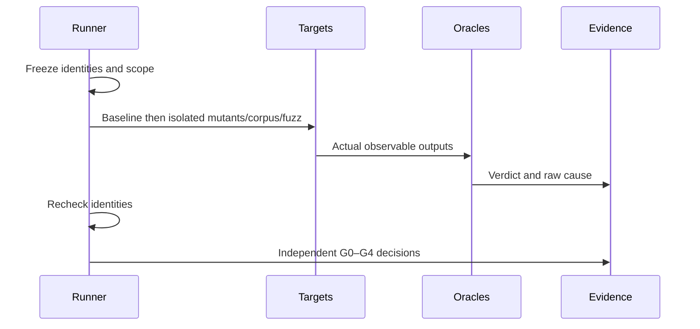

# Design

## Ownership and interfaces
- Core `tests/quality_native.py`: 编译当前维护模块的独立 Zig probe，读取固定实体语料、生成 PNG 并用 libpng 解码；私有源副本执行定向变异。无 V8/整库编译前置。
- Core `tests/quality_browser.py`/`quality_browser/`: 可复用同输入/同结果协议与固定 html5lib 社区选择。
- Core `tests/quality_fuzz.py`: 确定性 target、seed、ddmin、候选确认与回归重放；既有 PNG oracle 的实际缺陷按 before/after 冻结记录。
- 私有 `quality/differential.py`: 拥有三个真实浏览器的隔离启动/关闭；不复用用户会话。
- 私有 `quality/run.py`: 调用上述 CLI，保留原始日志与报告，检查身份、追踪关系并生成门禁；不重实现模块算法。

原生 CLI: `quality_native.py --output DIR [--zig PATH] [--cc PATH]`；报告含 identity/checks/mutations/artifacts。Fuzz 与 differential 消费明确工具/制品路径，缺失必须报出。输出目录必须新建，限制进程时间并收集退出码，不写用户源码或 Profile。

## Evidence contract
机器报告 schema=1。每条检查含 id、requirement、oracle、status、detail、scope/证据引用；变异额外含 source patch/hash、编译/运行退出码、对应断言与 baseline 身份。状态为 PASS/FAIL/UNSUPPORTED/KNOWN_FAIL/NOT_RUN/FLAKY；原始 ERROR/TIMEOUT/CRASH 不丢失，映射为 FAIL 并保留 cause。

身份包括源文件内容 SHA 与聚合 SHA、实际二进制 SHA、构建回执/配置、编译器及解码器版本/文件 SHA、语料 revision/license/SHA。路径不是身份。运行前后输入变化、旧 binary 与声明身份不匹配均拒绝。显式历史参考可执行并标 historical，不获得当前源码 G3/G4 资格。
执行结束重新校验构建回执/制品，比较各 child 实际记录的 runtime/decoder SHA，不能只记录启动时身份。浏览器适配器的当前 checkout 来源与 binary 构建来源分列；历史 reference 不冒充当前源码制品。

Requirement→Test→Oracle→Mutation→Evidence 由轻量 JSON manifest 定义；不要求不适用的检查伪造 mutation。KNOWN_FAIL 必须精确场景、理由、跟踪项与范围，不能由差分结果自动登记；UNSUPPORTED 必须有明确能力声明，均不算 PASS。
原生必需 test identities 固定于有 hash 的 `native_contracts.json`，不从受测源码自我推导最低执行集合。实体以完整查询加 native 表基数验证双向集合；变异只允许明确生产区间，不能修改 test helpers。

Fuzz candidate 同时保存原始/最小输入与各自 SHA、观测、seed、缩减关系和身份。公开 regression 使用与私有 candidate/promotion 相同的记录/replay 格式，删除机器路径但不改预期或历史观测；G0 实际重放该公开记录。历史修复 SHA 是来源而非未来永久源码锁；每次 replay 记录当前源码、工具和记录 SHA。

## Gates
| Gate | Scope | Admission |
|---|---|---|
| G0 | 当前独立模块编译、边界、基础回归、harness | 所有必需检查 PASS |
| G1 | 契约变异 | baseline PASS，至少十个有效变异被指定语义断言检出 |
| G2 | 固定社区输入、独立 oracle、参考差分 | 所有声明范围执行，差异逐项保留；不按多数投票定规范 |
| G3 | 真实 consumer、生命周期、资源 | 仅相同源码/制品身份且已执行场景可 PASS；模块不可代系统 |
| G4 | 发布闭包 | 全部适用证据、版本/风险资格完成才 PASS；本次不激活发布 |

每级独立生成状态、范围、原因与引用；默认要求的门禁有 FAIL/NOT_RUN 等即非零。可选择仅运行某级，但必须记录选择，未选级为 NOT_RUN。

## Mind-Test

| Event | State/decision |
|---|---|
| baseline 失败 | 变异 NOT_RUN，不能计杀伤 |
| mutant 编译失败/超时/崩溃 | INVALID/原始原因，不能计 KILLED |
| 未执行/少执行/旧制品 | FAIL 或 NOT_RUN；不能空集通过 |
| 参考实现不一致 | 保留三方观测，按规范归因；不能改预期修绿 |
| Fuzz 故障缩减变成另一异常 | 拒绝候选，保持原失败签名 |
| 缺少确认或错误身份 | 不提升回归；原始 finding 保留 |
| 并行修改源码 | 拒绝当前资格，保留已有快照结果；不改用户文件 |

性能：每种源码/配置复用编译产物，报告其身份；独立 probe 不启动完整浏览器；Fuzz 固定预算和 seed、缩减限次，证据只存必要样本/日志，不建调度服务。
