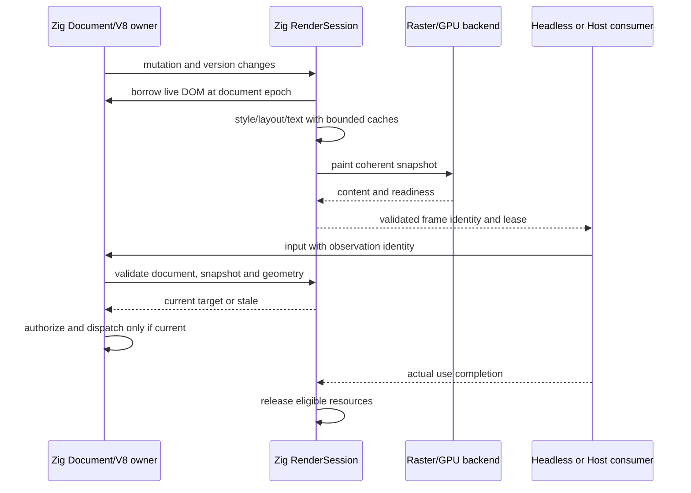

# Design: Zig 原生 Web Core

状态：目标设计并进入逐块实施。约束以 [spec](specs/zig-native-web-core/spec.md) 为准；[incremental](incremental.md) 定义静态 provider 与模块级滚动准入，替代原整体前置顺序；现状与证据见 [baseline](baseline.md)，Graphics 映射见 [graphics-integration](graphics-integration.md)。

## 1. 决策与替换边界

1. 沿用现有 Zig Document、V8 集成、Web API、导航/网络/存储与控制系统。迁移的是 Rust 当前承担的完整职责，不重建一套浏览器外壳。
2. 最终第一方语义与集成全部 Zig；Rust 的第三方算法/数据职责也必须被覆盖，不能只删除第一方 `.rs`。V8/C++、现有 C/系统基元和 Python/Node 工具各自保留独立来源。
3. 一个活 DOM；派生布局树不是第二套可变 DOM。Web API 不从渲染镜像读取脱离活 Document 的状态。同步几何查询、命中与绘制使用相容的准备结果。
4. engine 与 renderer 继续是两个可构建/验收的前端目标，复用同一 Zig Web 语义模块。不得因 standalone Rust CLI 更换而删除现有运行时身份、CDP/CLI/服务能力；逐项入口先盘点后迁移。
5. 支持边界保持 macOS arm64/CGL。重写语言不顺带改图形平台、实现 Graphics Host 或扩张平台承诺。正常 Headless 不启动 Desktop；managed 模式服从现有治理边界。
6. 每块独立构建/测试后静态切换，未迁移模块明确继续使用 Rust；同一入口不双派发、不运行时回退。仍只有一个 Rust 静态库，最终删除全部已替代入口/桥/依赖，Git 历史与来源保留。切换消费者和用户 Profile 仍按独立激活/恢复门禁执行。

## 2. 职责、目录与唯一状态所有者

目标复用 `runtime/engine/src/`，不新建平行的 `web-core2` 或通用 `shared` 包。下列新路径是实施目标，不是当前已经存在的模块。

| 职责 | 目标位置 / 现有复用点 | 唯一所有者与依赖规则 |
|---|---|---|
| 生命周期/任务 | 现有 browser/frame、Runner、Session | 会话/文档任务队列；关闭拒绝新任务，外部资源使用另结清 |
| 环境 | 现有 Python profile/native_spec；Zig 环境配置消费端 | Python 管持久配置/租约/迁移；Zig 使用验证后的环境快照，不自行生成身份 |
| 网络/存储/URL | 现有 network、storage；`sys/url.zig`、`sys/idna.zig` 的 Zig 实现 | 网络分区、Cookie、缓存与存储；URL 规范化供网络与 Web API 共用 |
| 解析/脚本/DOM | 现有 browser/parser、webapi、frame；新增 parser 内部 tokenizer/tree-builder/xml/encoding 模块 | Document 拥有节点与执行时序；Parser 调用现有节点工厂、定制元素与脚本入口 |
| CSS/布局/文字 | `browser/css/`、新增 `browser/layout/`、`browser/text/` | 现有 CSSOM 保持活对象；计算样式/布局/文字结果按版本派生，不生成第二套 CSSOM |
| 绘制/表面/资源 | 新增 `browser/paint/`、`browser/render/`；现有 canvas Web API | RenderSession 管准备/发布；Canvas/WebGL 管各自状态；资源缓存管理字节与租约 |
| 观察/控制/契约 | 现有 Zig server/cdp 与 Python control/refs/headless | 单独的控制租约/观察身份，消费渲染快照；不拥有第二份几何或 DOM |

`runtime/renderer/` 最终保留 Zig 前端/build 配置及必要资产，显式导入 engine 暴露的共用 Zig 模块；engine 不反向依赖该前端。Rust workspace 的可复用资产/fixture 先迁移并保留许可，再删除已替代实现。制品路径由新回执与 PINS 统一更新，不保留 Cargo 输出目录作为隐藏兼容层。

依赖方向：前端 → Web runtime → DOM/资源/样式/布局/文字/绘制模块 → 已批准基元。同仓 [GOS 契约](../../../mioa-os/api/README.md) 与 [C11 图形共享值类型](../../../mioa-os/api/graphics/graphics_types.h) 是独立上位契约，通用 Host 不导入 Web Core；具体服务/数据面尚无稳定 wire ABI，不能假定 endpoint 已实现。类型来源、standalone/managed、binding/input/budget/content/release 的逐项映射与内容摘要由 [接入映射](graphics-integration.md) 统一定义。后端适配不得把 Web 类型注入通用契约；本 change 不复制该契约。

## 3. 共用内部契约

以下是 Zig 源级契约，不是新增公共 wire/FFI ABI。实现前在对应模块定义确切类型/枚举；公开服务协议继续沿用现有版本。切换调用必须通过引用清单完成，不能保留无人维护的双轨 API。

| 边界 | 输入 / 输出 | 所有权、失败与单位 |
|---|---|---|
| Parser | document/context、解码字节、feed/finish/abort → 对现有 DOM 的有序操作与诊断 | 节点由 Document 拥有；chunk 可跨编码序列；脚本重入排队；恢复性语法错误不是内存/取消成功 |
| Encoding | 编码标签、decoder 状态、输入、输出容量、flush/fatal/BOM → consumed/written/status | handle 有明确 reset/free；不能把 OutputFull 当消费完；导航、CSS、FileReader、表单与 TextDecoder 共享表/算法 |
| URL/IDNA | UTF-8 input/base、组件修改 → URL record/序列化/origin 或错误 | setters 在验证后提交；借用寿命不得跨 mutation；统一 UTS#46 数据与 WHATWG 算法，不以 RFC URI/裸 punycode 代替 |
| Text | 已验证 font key、Unicode、方向/语言/script、CSS 字距/variation → glyph runs、cluster 映射、度量 | CSS 几何单位；UTF-16 DOM offset 与 UTF-8 backing index 显式转换；布局/caret/raster 共用 glyph/font 选择 |
| Prepare | document handle、变更集合、viewport/DPR、媒体模式、受控时间、资源版本 → PreparedSnapshot | 对 Document 只读借用；共享不可变资产允许；不暴露可被外界独立修改的 DOM 副本 |
| Geometry | snapshot key、node generation、CSS-space 坐标/offset → rect/metrics/hit/caret 或 stale/unavailable | 无效节点/过期快照拒绝；滚动、clip、transform、子帧坐标与绘制一致；当前 Rect 无法精确表达的 iframe caret rotation/skew 或退化变换保持明确 unavailable，不以可逆矩阵或近似 AABB 冒充精确插入位置 |
| Paint/Surface | snapshot、capture region、资源/Canvas lease → CPU image 或已协商 GPU 内容 | pixel width/height/stride 为整数并检查乘加溢出；格式/alpha/色彩空间独立标注，不从长度猜格式 |
| Export | content identity、LPFR slot/use → 写入结果、后续发布/使用/释放事件 | 写入不等于发布；producer ready、consumer use 与完成是不同状态；外部读者结束前不回收 |

`SnapshotKey` 的语义字段：session/document epoch、DOM/CSS/resource/animation/selection 版本、viewport/DPR、媒体/时间采样与子帧身份。一致性元组还包含 root/element resolved-scroll generation、影响样式的 hover/active/focus 等交互状态代次、引用的 Canvas/WebGL/OffscreenCanvas/子帧表面的 content generation；可纳入 SnapshotKey 或其绑定的 visual-state key。仅滚动/表面更新不强制重建样式布局，但 paint、hit、caret、指纹与发布必须绑定相同视觉状态。实现可组合摘要，不得仅比较像素或指针；节点 ID 不跨文档/回收代次复用。

例如：文档 A 的快照 s1 被观察后导航到 B；即使 B 输出相同像素，`input(s1, node)` 必须 stale 且不派发。DOM Text 的 offset=1 表示 UTF-16 代码单元位置；控制 backing 的 UTF-8 字节位置不能直接当作该 offset 使用。

内部错误至少区分内存不足、输入不合法、陈旧身份、资源不可用、预算/队列耗尽、取消、必需能力缺失与派发后结果未知。映射到现有公开错误体系时保留原因；新增公开码先更新消费者契约。HTML 恢复错误、URL validation error 与致命失败分别处理。

## 4. 活 DOM → 准备 → 发布 → 输入

解析脚本执行与 DOM 变更的权威留在现有 owner loop。后台资源完成只提交版本化结果，不跨线程直接改活 DOM。GPU 上下文按现有线程约束管理；迁移原 Rust Mutex 时先证明线程交接和并发读取约束，不以“改成 Zig”当作同步依据。

| 共享状态 | 写入者 / 同步 | 失效与释放 |
|---|---|---|
| active Document + node generations | Document owner loop；脚本重入使用现有排队/检查点 | 导航/关闭阻止旧回调提交，已可见脚本副作用不回滚或重放 |
| prepared snapshot + version tuple | RenderSession；发布后只读 | 任何关联版本变化使旧输入失效；读者持有期间不可悬空 |
| font/image bytes + decoded cache | 资源 owner；不可变条目可共享，key 包含 Profile/资产摘要/variation | 失败、替换、淘汰与 document cancellation 分开；在途使用计入占用 |
| Canvas/WebGL state | context owner；Worker 转移使用代次与实际交接 | resize/transfer/close 按 API 规则；device loss 不等于所有 use 已完成 |
| exported frame/resource use | producer 发布、consumer 完成；沿用 LPFR 原子协议 | 关闭/超时仅停止新 use，实际完成或安全终止后回收 |
| Profile config/storage | 现有跨进程租约与原子提交 | 原生升级不得修改身份；冷快照不覆盖升级后新写入 |

不引入跨进程强一致数据库或全局渲染单例。连接故障时优先拒绝新工作并保留未知状态；绝不把断连解释为副作用未执行或 GPU 已完成。

## 5. 依赖替换策略与准入

- **HTML/XML/URL/编码**：Zig 实现状态机/树构造，重用现有 DOM sink 与生命周期；固定实体、编码和 Unicode 数据来源/版本/生成工具。现有 Zig wrapper 不是替换算法。SuperHTML 仅作 tokenizer/数据复用候选，其验证器定位不证明具备浏览器错误恢复/流式/脚本重入能力。
- **CSS/布局**：复用现有 Zig CSSOM，补齐原 Rust 计算样式、布局与 retained invalidation 职责；不把 Taffy API 名称机械换成 Zig 名称当作布局完成。
- **文字**：Zig 拥有字体选择、CSS 度量/排版、cluster/selection 和缓存；优先评估 HarfBuzz/FreeType 等非 Rust 字体基元，系统 CoreText 可作当前平台候选。仅从固定 Profile 字体资产创建字体，禁止扫描系统字体或无证据替换 variation/bidi/line-break 行为。具体基元必须通过 D1 实验并锁定后才能依赖它实施。
- **绘制/图片/SVG**：Zig 拥有绘制顺序、clip/transform/blending、SVG 与 Canvas 语义；只允许经评估的路径栅格/解码/压缩基元。记录格式、色彩与 alpha 支持，不能把 Rust librsvg 或预编译 Rust codec 误当成 C 替代。保留既有图片格式与字体解码能力，新增依赖先锁定、审许可和故障边界。
- **WebGL**：Zig 接管对象/状态/参数/命令处理与 CGL 调用，保留 Profile 指定后端、纹理范围验证、上下文线程所有权和现有真实 GPU 测试；通用 Host 不成为 WebGL 状态权威。
- **standalone renderer**：优先复用 Zig engine 的 DOM/V8/网络/存储，逐项迁移原 CLI/CDP/MCP 等真实入口；不得只移植 engine 的较窄适配路径。WPT testdriver 是测试适配，不取代生产控制协议。

D1 前不选入未经核实的新增库。D1 的输出必须是实际版本/源码 hash/许可/特性开关/Unicode 数据/ABI 与失败实验，不是“未来用某库”的占位依赖。无法覆盖既有行为的候选被淘汰，影响的是该实施任务可开工性，不缩减接管范围。

## 6. 性能不变量与演化边界

- 准备缓存命中不能先遍历并 JSON 序列化整棵未变 DOM；以实际变更和版本驱动。复杂失效可安全重算，但不得未经测量宣称全量重算更快。
- 布局树、glyph runs、解码图像与 prepared scene 是必要派生缓存，不以“一个 DOM”删除它们。共享仅限身份相容的不可变数据，预算与占用可追溯。
- 连续帧展示/订阅路径不以控制消息承载整帧编码像素，沿用 LPFR 或已协商资源路径；现有显式 screenshot、打印及其他公开导出 API 按既有协议返回内容，不因本约束删改其语义。
- CPU/LPFR 路径允许已声明且有预算的 GPU readback 和有界拷贝，Web 同步 readback 仍真实执行。未来已协商的 GPU 展示路径不得为展示强制 readback/re-upload；本变更不因此要求实现新 GPU 展示后端。
- 缓存 key 包含资源版本/字体与 variation/环境/媒体等实际语义，不只 URL 或节点指针。固定路径的旧内容替换不能命中旧度量。
- 输入和关闭路径不被长渲染全局锁阻塞；已接受的键/按钮转换不得合并丢弃。无实际执行域支持时不承诺任意抢占或硬配额。
- 后续 Worker、GPU 后端、更多排版与多 consumer 通过独立 context、版本化快照和资源 use 扩展；不增加另一棵 DOM，不把 Web 语义推入 Graphics API。

性能验收记录同机/同配置/同 corpus 的 CPU、分配次数/字节、峰值驻留、准备/绘制时间、帧拷贝/readback 和稳定态行为。当前没有可信绝对性能门槛或改善比例；D0 实测后冻结噪声范围与逐用例预算，再判断回归，禁止拿思想实验数字当测量值。

## 7. Mind-Test 与修正后的约束

| 场景 | 状态转移 / 预期 | 阻断错误 |
|---|---|---|
| 分块字符 + document.write | decoder 保留尾字节；重入追加队列；finish 后合法结清 | 沿用旧 streaming 按 chunk UTF-8 校验会静默丢字节，必须按标准纠正并加回归 |
| parse callback 导航/取消 | 旧 epoch 停止提交；已执行脚本保留可观察事实 | 恢复旧快照后重放脚本、旧节点回调 UAF |
| 字体/图片迟到 | resource version 更新 → 重新选择/度量/布局 → paint/hit/caret 同版本 | 只 repaint 不更新 intrinsic size 或继续用旧 caret |
| 相同像素的新文档/子帧 | document/subframe epoch 变化 → 旧 observation stale | 只 hash 像素导致点击旧节点 |
| Worker GL + placeholder paint | 线程所有权/交接成立，渲染持有效表面 use | 把原 Mutex 删除而形成两个可变访问者 |
| close/device loss + 在途帧 | 禁止新 use；原 use 结清后回收旧代次 | timeout/断连直接释放、晚到完成释放新资源 |
| print 后返回 screen | 媒体/时间/viewport 版本重新准备，缓存隔离 | 打印样式或背景策略污染常规渲染 |
| 新 binary/font + 旧 Profile | admission 拒绝 → 显式冷迁移 → 原子激活 | 清空存储、改 seed 或绕过 artifact digest |

此推演识别了流式旧行为、双 DOM、字体/动画版本、完成/释放混淆等风险，已写入 Z2/Z4/Z6/Z7/Z10。思想实验完成不表示对应实现或测试已经通过。

## 8. 实施顺序与切换条件

按 [incremental](incremental.md) 推进：全局安全基线持续运行，各模块滚动完成对应 D0/D1 后进入实现与差量验证；独立块不等待完整 WPT/未来 Graphics Host。parser/编码/URL、文字/资源可在真实契约独立时并行；CSS/布局/paint 的共享快照需要组合验收。D7 的整体 Rust 清退和消费者激活仍晚于全部相关模块完成。

每块先固定全部调用与行为测试，再实现、真实入口验证和静态切换；保留其余未迁移实现不是运行时兜底。整体目标不缩减，中间结果按块报告，不能宣称完整 Zig 接管。
